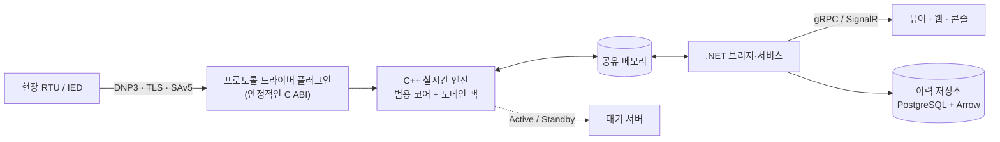
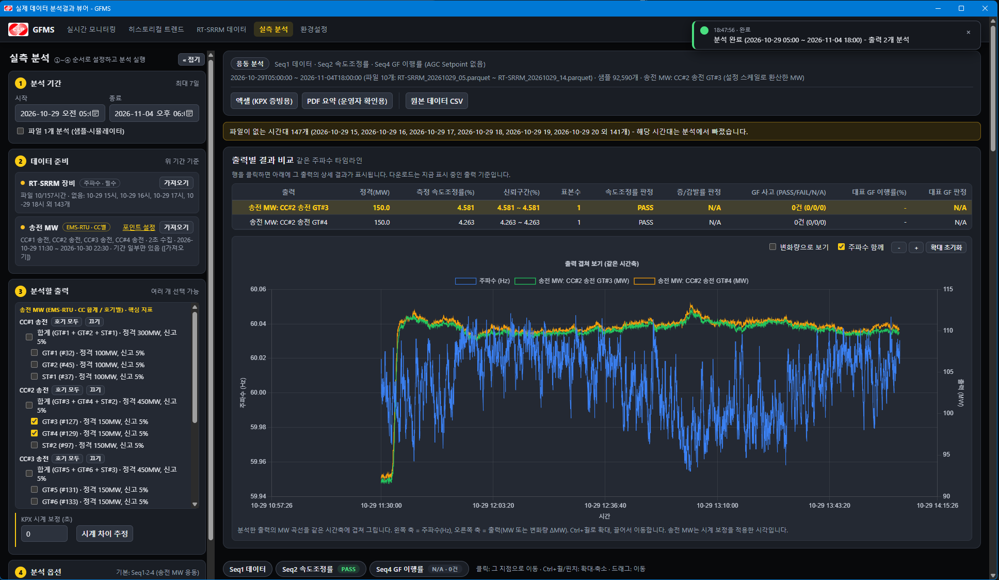
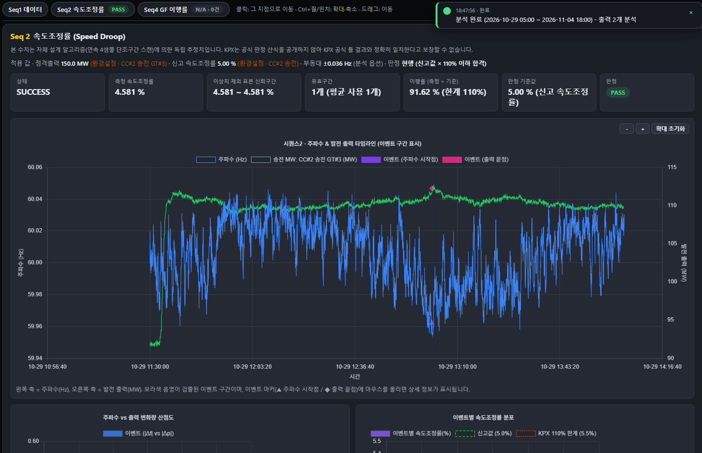

  

  
  

<h3 align="center">김두용 · キム ドゥヨン · DuYong Kim</h3>

<i>こんにちは。電力・産業分野のソフトウェアアーキテクトです。</i>

 
 
<h3>안녕하세요 👋</h3> 
김두용입니다. 
전력 시스템과 산업 자동화를 위한, 믿고 쓸 수 있는 소프트웨어를 만듭니다. 
오늘도 즐거운 하루 보내세요.

  

 

---
## **경력 요약**

> **공장 자동화, 디지털 변전소, 전력 운영 분야에서 10년 넘게 일해 온 전력 시스템 소프트웨어 아키텍트입니다.**
> 현장 장치 통신부터 운영자 화면까지 SCADA 시스템 전체를 설계하고, 국가 기반시설에서 믿고 쓸 수 있는 수준으로 만듭니다.

 

| | |
|---|---|
| **현재** | 기술 리드 · 차세대 크로스플랫폼 SCADA 플랫폼 아키텍트 (C++ 실시간 엔진 · .NET 서비스 · DNP3 · IEC 62443 보안 내재화 설계) |
| **도메인** | 변전소 자동화(IEC 61850), 집중 감시, RTU 연동, DNP3 원격 감시, 전력 시장(KPX) 정산, 산업용 HMI |
| **강점** | 현장에서 검증된 레거시 동작을 깔끔하고 시험 가능한 아키텍처로 옮기는 일 — 레거시 분석 → 실행 가능한 명세 → 단계별 구현 |
| **범위** | 임베디드에서 웹까지 풀스택: Qt/C++ HMI, 공유 메모리 IPC, ASP.NET Core API, Vue/Nuxt 웹 확장, 실시간 2D/3D 시각화 |
| **일하는 방식** | Claude Code를 활용한 AI 보조 엔지니어링 — 빠르게 결과를 내되, 설계 결정과 검증은 제가 책임집니다 |

 

---

 
<h3>💻 기술 스택</h3>

 

| | |
|---|---|
| **언어** |  |
| **프레임워크** |  |
| **데이터·빌드** |  |
| **그 외** |            |

 

<h3>⚡ 전력·OT 표준</h3>

     

 

---

## **경력**
  

_2025.04 ~ 현재_

**대한민국 - LK11**  
회사 소개 · 인원 19명
- 소프트웨어·하드웨어 제조 / 중소기업
- 연 매출 32억 원
- 전력 시스템 솔루션, 산업 자동화

사업 분야:
전력 시스템 솔루션 ·
SCADA HMI·자동화 ·
산업 제어·통신

**기술사업부**
**선임연구원 (기술 리드)**

- **주요 프로젝트:** LS일렉트릭 STATCOM 시스템 / 한국동서발전(EWP) KPX 보조서비스 정산 시스템 (GFMS — 아래 *프로젝트 2* 참고)
- **전력 도메인 전문성:** 변전소 집중 감시, RTU 장비 연동, 상위 통신, KPX 정산 절차까지 전력 분야 전반을 폭넓게 이해합니다.
- **현장 중심 SCADA HMI 개발:** 현장 엔지니어와 긴밀히 협업해 운영상의 요구를 실용적인 기능으로 옮겼고, 고객사와 지사에서 높은 평가를 받았습니다.
- **시스템 아키텍처·통합:** 핵심 분석 엔진, 상위 통신(DNP3), 장치 데이터 수집 시스템을 설계했습니다.
- **차세대 SCADA 플랫폼 (2026, 진행 중):** 크로스플랫폼 SCADA 제품의 아키텍처와 명세를 단독 설계자로 이끌고 있습니다 — 레거시 분석, 제품 아키텍처, 보안(IEC 62443) 설계, 실행 가능한 명세. 아래 *프로젝트 1* 참고.
- **기술 스택:** Python, .NET Aspire, ZENON E/E Engineering, IEC 61131-3, DNP3

  

_2024.08 ~ 2025.04_

**회사 4**

**대한민국 서울 - Wezon**  
회사 소개 · 인원 199명
- 시스템 통합 / 시스템 운영
- ICT·IoT 전문 솔루션
- 산업 네트워크, 모니터링 서버·스토리지

사업 분야:
DX·ESG 컨설팅 ·
플랜트 IT 솔루션 전문 ·
시스템 통합(SI, ERP, WMS 등)

**시스템 통합 / 현장 통합팀**
**Senior Manager**

  

_2023.03 ~ 2024.08_

**회사 3**

**대한민국 서울 - SoftOne**  
회사 소개 · 인원 146명
- 유통 사업부
- 이커머스 사업부
- 공공 사업부
- 솔루션 사업부

사업 분야:
컨설팅 ·
시스템 개발 ·
시스템 통합 ·
시스템 운영

**시스템 유지보수 / 구축 사업팀**
**Senior Assistant**

  

_2019.09 ~ 2023.01_

**회사 2**

**대한민국 인천 - SANION**  
회사 소개 · 인원 72명
- 개발·설계 37명 (박사 2명, 석사 7명 포함)
- 시운전 17명
- 영업·구매 18명

사업 분야:
변전 자동화 ·
배전 자동화 ·
배전반

**개발 / 소프트웨어**
**Assistant Manager**

  

_2015.06 ~ 2019_

**회사 1**

**대한민국 서울 - WELLTAC**  

사업 분야:
공장 자동화 인프라, HMI 솔루션

**개발 / Staff**

  

---

## **프로젝트**
  

*프로젝트 1*

## 차세대 SCADA 플랫폼 — 아키텍처·명세 설계   

### 개요

전력 변전소 감시·제어용 크로스플랫폼(Windows · Linux) SCADA 제품의 설계입니다. 현장에서 검증된 레거시 시스템을, 그 동작을 잃지 않고 대체하는 것이 목표입니다. 단독 아키텍트로서 설계 단계 전체를 맡고 있습니다 — 레거시 분석, 제품 아키텍처, 보안 설계, 시험 명세, 마일스톤 계획. 구현 단계는 이 명세를 바탕으로 시작합니다.

 

### 아키텍처 한눈에 보기

### 한 일

- **레거시 분석 → 재사용 가능한 규칙**: 서로 다른 레거시 SCADA 소스 코드를 분석하고 상용 SCADA 플랫폼을 벤치마킹했습니다. 통신 절차, 제어 순서, 이벤트 로직을 규칙 ID로 정규화하고, 이를 규범 명세 역할을 하는 **약 500건의 실행 가능한 시험 벡터**(입력 → 기대 출력)로 만들었습니다.
- **제품 아키텍처**: C++ 실시간 엔진 + 공유 메모리 IPC + .NET 서비스 계층. 프로토콜 드라이버는 안정적인 C ABI 뒤의 플러그인으로 두고 드라이버 적합성 시험 키트를 갖췄습니다. 범용 엔진 코어 + 도메인 팩 구조로, 엔진 하나로 여러 시장에 대응합니다.
- **전력 통신**: DNP3(IEEE 1815) 마스터 설계 — 다중 세션, 비요청 응답, 보안 인증(SAv5), TLS — 와 회선 이중화, 서버 Active/Standby 이중화.
- **보안 내재화 설계**: IEC 62443-4-1 / 4-2 요구 매트릭스, 해시체인 감사 로그, 드라이버 서명, 첫 마일스톤부터 CI에 SBOM·정적 분석 적용.
- **이력 저장소**: 이벤트는 PostgreSQL, 트렌드는 Apache Arrow 청크 저장 + 다단계 축소본으로 빠른 차트 표시.
- **제품화**: 에디션별 라이선스(태그 한도, 오프라인 서명 라이선스), 다중 콘솔 동기화, RTU DB 업로드/다운로드와 Excel 가져오기/내보내기.
- **계획**: 기술 명세 문서 13건과 마일스톤 계획(M0–M8 + 보안 인증 단계). 각 마일스톤은 수용 시험 시나리오 ID로 완료를 판정합니다.

### 일한 방식 — AI 보조 엔지니어링

설계 단계는 **Claude Code**를 엔지니어링 보조 도구로 삼아 진행했습니다. 범위와 규칙을 정하고, 모든 설계 결정을 내리고, 현장 지식으로 미결 사항에 답하고, 결과물을 검토·검증한 것은 제가 했습니다. AI는 대규모 레거시 코드 읽기, 문서 초안, 시험 벡터 생성을 빠르게 해 주었습니다. 모르는 것은 추측하지 않고, 가정·영향·확인 방법을 기록한 뒤 해결했습니다.

 

### 기술

C++ (ACE), CMake / vcpkg, .NET 10, gRPC / SignalR, .NET Aspire, 공유 메모리 IPC, DNP3 / SAv5 / TLS, IEC 62443, IEC 62351, PostgreSQL, Apache Arrow, LightningChart JS, Claude Code

  
  

*프로젝트 2*

## Governor Free Measurement System (GFMS) — 분석 엔진·뷰어   

*LK11 · 한국동서발전(EWP) KPX 보조서비스 정산 시스템*

### 개요

발전기가 계통 주파수 변화에 어떻게 응답하는지(조속기 자유운전, Governor Free)를 전력거래소(KPX)의 보조서비스 평가와 같은 방식으로 평가하는 측정·분석 시스템입니다. 발전소에서 GNSS로 시각을 맞춘 고분해능(100ms) 주파수와 발전 출력을 수집하고, 속도조정률, AGC 증/감발률, 주파수 응답 이행률을 계산합니다. 발전소는 공식 평가 전에 결과를 미리 확인하고 증빙을 준비할 수 있습니다.

 

 
 

 

### 한 일

- **규정 → 알고리즘**: KPX 평가 규정을 정밀한 알고리즘 명세로 옮겼습니다 — 유효구간 검출(부동대, 연속 상승·하락, Threshold), 구간별 속도조정률, 상위 5% 제거, 합격 판정.
- **차이 분석·구조 재설계**: 기존 평가 로직을 규정과 대조해 어긋난 부분을 찾고, 엔진을 모듈로 재구성했습니다 — 입력 검증, 전처리, 구간 검출, 평가, AGC 증/감발률, 주파수 응답, 판정.
- **설정 기반 판정**: 판정 기준을 모드로 선택할 수 있고, 확인이 필요한 규정 해석은 모두 코드가 아닌 설정값으로 두었습니다.
- **KPX와 같은 데이터 기준**: 100ms 원시 데이터를 KPX가 쓰는 단위로 리샘플하고, 조속기 스텝시험 분석용 고분해능 모드는 따로 유지했습니다.
- **재현성**: 모든 결과에 엔진 버전, 설정 해시, 입력 구간, 리샘플 방식을 기록하고, 발전소 DCS 값과 EMS-RTU 값을 교차 검증합니다. 시험 케이스는 규정 문서의 산정 예시로 만들었습니다.
- **분석 뷰어**: 여러 호기 비교, 주파수·출력 겹쳐 보기와 검출 이벤트 표시, Excel(KPX 증빙용)·PDF 요약·원본 CSV 내보내기.

### 기술

Python, pandas, Parquet, YAML 설정, pytest, Excel / PDF 보고서

  
  

*프로젝트 3*

## 디지털 변전소 HMI — 웹 확장  

### 개요

데스크톱 SA HMI를 웹으로 확장해, 같은 변전소 데이터와 엔지니어링 기능을 브라우저에서 쓸 수 있게 했습니다.

 
 

 
 

 
 

 
 

 
 

  

### 한 일

- **API 서버**: 웹 클라이언트에 변전소 데이터를 제공하는 백엔드 API 서버를 만들었습니다.
- **웹 엔지니어링 UI**: 엔지니어링 기능을 프런트엔드로 옮겼습니다.
- **2D·3D 시각화**: 브라우저에서 2D 도면과 3D 화면을 구현했습니다.
- **실시간 데이터**: 실시간 통신 데이터를 웹으로 전달했습니다.

### 기술

ASP.NET Core (.NET 5), EF Core, Node.js, Vue.js / Nuxt.js, HTML5 / CSS, Konva.js, LightningChart JS

  
  

*프로젝트 4*

## 디지털 변전소 HMI (SA System)   

### 개요

**IEC 61850 기반 디지털 변전소**의 운영자 HMI입니다. 변전소의 모든 베이와 장치를 실시간으로 보여 주는, 변전 자동화(SA) 시스템의 운영 화면입니다.

 

 
 
 

  

### 한 일

- **그래픽 객체 모델**: 2D 그래픽 객체를 객체지향 모델로 설계해, 화면 요소를 그림이 아닌 재사용 가능한 부품으로 만들었습니다.
- **엔지니어링 도구·그래픽 빌더**: 엔지니어가 코드 없이 운영 화면을 구성하는 GUI 엔지니어링 도구를 만들었습니다.
- **공유 메모리 IPC**: HMI와 통신 프로세스를 공유 메모리로 연결하고, 실시간 데이터를 화면에 바인딩했습니다.
- **실시간 데이터**: 현장 통신 데이터를 실시간으로 처리하고 표시했습니다.

### 기술

Qt (QML · Widgets), C++, 공유 메모리 IPC

 
 
 

