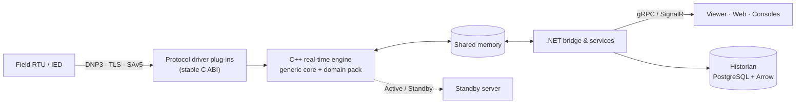
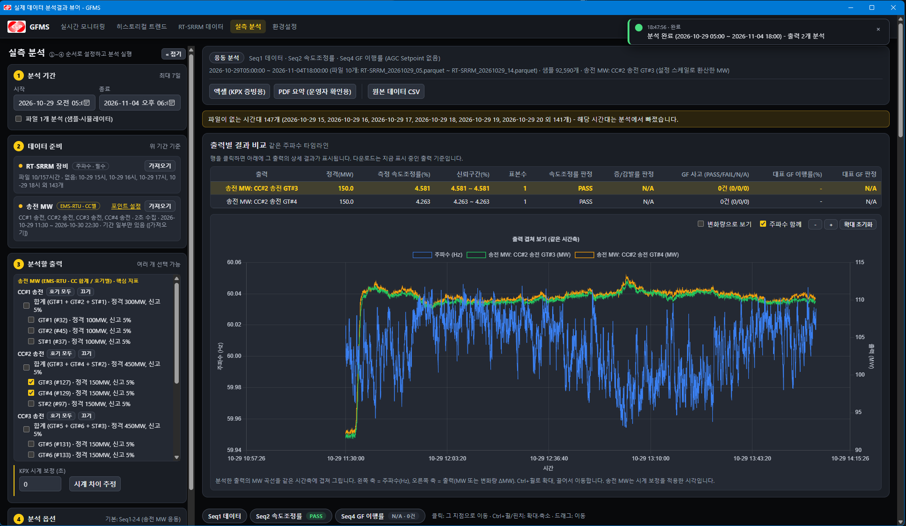
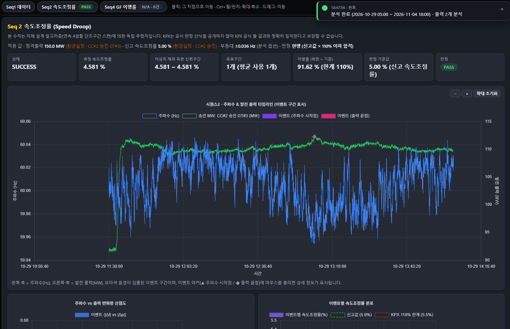

  

  
  

<h3 align="center">김두용 · キム ドゥヨン · DuYong Kim</h3>

<i>こんにちは。電力・産業分野のソフトウェアアーキテクトです。</i>

 
 
<h3>Hi there 👋</h3> 
Hello, I'm Kim. 
I build reliable software for power systems and industrial automation. 
Have a day full of JOY today.

  

 
<!--  -->

---
## **Career Summary**

> **Power-system software architect with 10+ years across factory automation, digital substations and grid operations.**
> I design SCADA systems end to end — from field device communication to the operator's screen — and I build them to be trusted in critical infrastructure.

 

| | |
|---|---|
| **Now** | Technical Lead · Architect of a next-generation, cross-platform SCADA platform (C++ real-time engine · .NET services · DNP3 · IEC 62443 security by design) |
| **Domain** | Substation automation (IEC 61850), centralized monitoring, RTU integration, DNP3 telemetry, power-market (KPX) settlement, industrial HMI |
| **Strength** | Turning field-proven legacy behavior into clean, testable architecture — legacy analysis → executable specifications → staged delivery |
| **Range** | Embedded-to-web full stack: Qt/C++ HMI, shared-memory IPC, ASP.NET Core APIs, Vue/Nuxt web extensions, real-time 2D/3D visualization |
| **Way of working** | AI-assisted engineering with Claude Code — faster delivery, with design decisions and verification owned by me |

 

---

 
<h3>💻 Tech Stack</h3>

 

| | |
|---|---|
| **Languages** |  |
| **Frameworks** |  |
| **Data & Build** |  |
| **More** |             |

 

<h3>⚡ Power & OT Standards</h3>

       

 

---

## **Career History**
  

_April. 2025 ~ Present_

**South Korea - LK11**  
Company Description,
total number of people: 19
- Software & Hardware Manufacturing / SME
- Annual Revenue: 3.2 Billion KRW
- Power System Solutions & Industrial Automation

Business :
Power System Solutions
SCADA HMI & Automation
Industrial Control & Communication

**Technical Business Division**
**Senior Research Engineer (Technical Lead)**

- **Key Projects:** LS Electric STATCOM System / Korea East-West Power (EWP) KPX Ancillary Service Settlement System (GFMS — see *Project 2*)
- **Power Domain Expertise:** Comprehensive knowledge across the power domain ecosystem, including substation centralized monitoring, RTU equipment integration, upper-level communication, and KPX settlement processes.
- **Field-Centric SCADA HMI Development:** Led HMI development in close collaboration with field engineers, translating operational needs into practical features that received high praise from clients and branch offices.
- **System Architecture & Integration:** Architected core analysis engines, upper-level communication (DNP3), and device data acquisition systems.
- **Next-Generation SCADA Platform (2026, in progress):** Leading the architecture and specification of a cross-platform SCADA product as the sole designer — legacy analysis, product architecture, security (IEC 62443) design and executable specifications. See *Project 1* below.
- **Tech Stack:** Python, .NET Aspire, ZENON E/E Engineering, IEC 61131-3, DNP3

  

_August. 2024 ~ April. 2025_

**Company 4**

**Seoul, South Korea - Wezon**  
Company Description,
total number of people: 199
- System Integration / System Management
- ICT & IoT specialized solution
- Industrial network and monitoring Server and storage

Business :
DX & ESG consulting
Plant IT solution specialized company
system integration
SI, ERP, WMS, etc.

**System Integration / Field Integration Team**
**Senior Manager**

  

_March. 2023 ~ August. 2024_

**Company 3**

**Seoul, South Korea - SoftOne**  
Company Description,
total number of people: 146
- Distribution Division
- E-commerce Division
- Department of Public Works
- Solution Division

Business :
consulting 
system development
system integration
system management

**System Maintenance / Construction Business Team**
**Senior Assistant**

  

_Sept. 2019 - Jan. 2023_

**Company 2**

**Incheon, South Korea - SANION**  
Company Description,
total number of people: 72
- Development/Design: 37(Including 2 PhDs, 7 M.S.D.s)
- Commissioning: 17
- Sales/Purchase: 18

Business :
Substation Automation,
Distribution Automation,
Distribution Panel

**Development / Software**
**Assistant Manager**

  

_Jun. 2015 - 2019_

**Company 1**

**Seoul, South Korea - WELLTAC**  

Business :
Factory automation infrastructure, HMI solution

**Development / Staff**

  

---

## **Project**
  

*project 1*

## Next-Generation SCADA Platform — Architecture & Specification   

### Overview

Design of a cross-platform (Windows · Linux) SCADA product for power substation monitoring and control, built to replace field-proven legacy systems without losing their behavior. I own the whole design phase as the sole architect: legacy analysis, product architecture, security design, test specification and milestone planning. The implementation phase starts from this specification set.

 

### Architecture at a glance

### What I did

- **Legacy analysis → reusable rules**: Analyzed the source code of different legacy SCADA systems and benchmarked a commercial SCADA platform. Normalized communication procedures, control sequences and event logic into rule IDs, then into **~500 executable test vectors** (input → expected output) that serve as the normative spec.
- **Product architecture**: Real-time C++ engine + shared-memory IPC + .NET service layer, with protocol drivers as plug-ins behind a stable C ABI and a driver conformance test kit. Generic engine core + domain packs, so one engine can serve multiple markets.
- **Power communication**: DNP3 (IEEE 1815) master design — multi-session, unsolicited reporting, Secure Authentication v5, TLS — plus dual-line and Active/Standby server redundancy.
- **Security by design**: IEC 62443-4-1 / 4-2 requirement matrix, hash-chained audit log, signed drivers, SBOM and static analysis in CI from the first milestone.
- **Historian**: PostgreSQL for events + Apache Arrow chunked trend storage with multi-level downsampling for fast charting.
- **Productization**: Edition-based licensing (tag limits, offline signed license), multi-console synchronization, RTU database upload/download with Excel import/export.
- **Planning**: 13 technical specification documents and a milestone plan (M0–M8 + security certification phases), each milestone gated by acceptance-test scenario IDs.

### How I worked — AI-assisted engineering

I ran the design phase with **Claude Code** as an engineering assistant. I set the scope and rules, made every design decision, answered open questions from field knowledge, and reviewed and verified the output; the AI accelerated reading large legacy codebases, drafting documents and generating test vectors. Open questions were never guessed — they were recorded with assumptions, impact and a verification method, then resolved.

 

### Tech

C++ (ACE), CMake / vcpkg, .NET 10, gRPC / SignalR, .NET Aspire, Shared Memory IPC, DNP3 / SAv5 / TLS, IEC 62443, IEC 62351, PostgreSQL, Apache Arrow, LightningChart JS, Claude Code

  
  

*project 2*

## Governor Free Measurement System (GFMS) — Analysis Engine & Viewer   

*LK11 · Korea East-West Power (EWP) KPX Ancillary Service Settlement System*

### Overview

A measurement and analysis system that evaluates how power-plant generators respond to grid frequency (governor-free response), in the same way the Korea Power Exchange (KPX) assesses ancillary services. It collects high-resolution (100 ms), GNSS-synchronized frequency data and generator output at the plant, then calculates speed droop, AGC ramp rates and frequency-response compliance — so the plant can check its results before the official evaluation and prepare evidence.

 

 
 

 

### What I did

- **Regulation → algorithm**: Turned the KPX evaluation rules into a precise algorithm spec: valid-interval detection (deadband, consecutive trend, threshold), per-interval speed droop, top-5% outlier removal and pass/fail judgement.
- **Gap analysis & re-architecture**: Compared the existing evaluator with the rules, found where it diverged and restructured the engine into modules — input validation, preprocessing, interval detection, evaluation, AGC ramp, frequency response, judgement.
- **Configurable judgement**: Judgement criteria are selectable by mode, and every rule interpretation that needs confirmation lives in configuration, never in code.
- **KPX-equivalent data path**: Resampled 100 ms raw data to the resolution KPX uses, while keeping a high-resolution mode for governor step-test analysis.
- **Traceability**: Every result records engine version, config hash, input range and resampling mode; plant DCS and EMS-RTU values are cross-checked; test cases are built from the rule documents' worked examples.
- **Analysis viewer**: Multi-unit comparison, frequency/output overlay with detected-event markers, and export to Excel (evidence for KPX), PDF summary and raw CSV.

### Tech

Python, pandas, Parquet, YAML configuration, pytest, Excel / PDF reporting

  
  

*project 3*

## Digital Substation HMI — Web Extension  

### Overview

Extended the desktop SA HMI to the web, so the same substation data and engineering functions are available in a browser.

 
 

 
 

 
 

 
 

 
 

  

### What I did

- **API server**: Built the back-end API server that serves substation data to web clients.
- **Web engineering UI**: Brought the engineering functions to the front end.
- **2D & 3D visualization**: Implemented 2D diagrams and 3D views in the browser.
- **Real-time data**: Delivered live communication data to the web in real time.

### Tech

ASP.NET Core (.NET 5), EF Core, Node.js, Vue.js / Nuxt.js, HTML5 / CSS, Konva.js, LightningChart JS

  
  

*project 4*

## Digital Substation HMI (SA System)   

### Overview

Operator HMI for **IEC 61850-based digital substations**. It gives operators a real-time view of every bay and device in the substation and is the operating screen of the Substation Automation (SA) system.

 

 
 
 

  

### What I did

- **Graphic object model**: Designed an object-oriented model for 2D graphic objects, so screen elements are reusable components rather than drawn shapes.
- **Engineering tool & graphic builder**: Built the GUI engineering tool that lets engineers compose operating screens without code.
- **Shared-memory IPC**: Connected the HMI to the communication processes through shared memory, and bound live data to the screen.
- **Real-time data**: Processed and displayed field communication data in real time.

### Tech

Qt (QML · Widgets), C++, Shared-memory IPC

 
 
 

